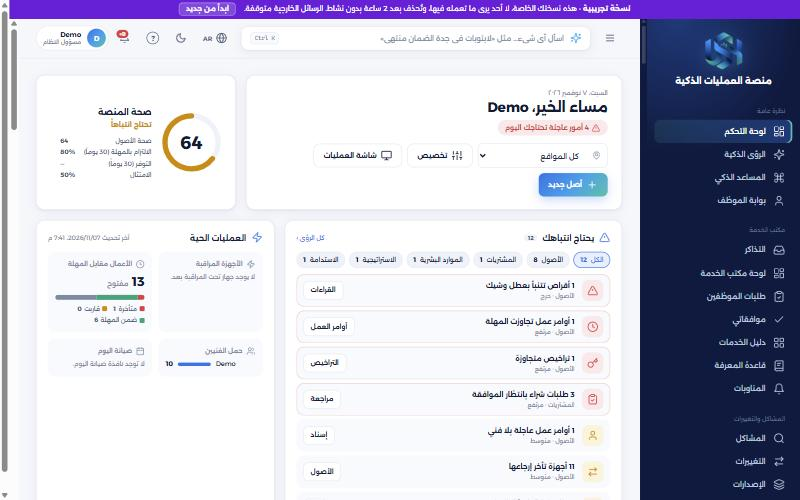
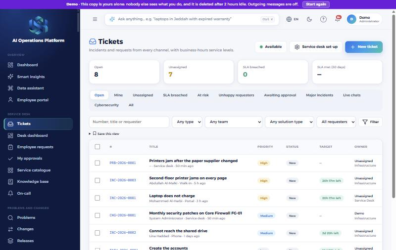
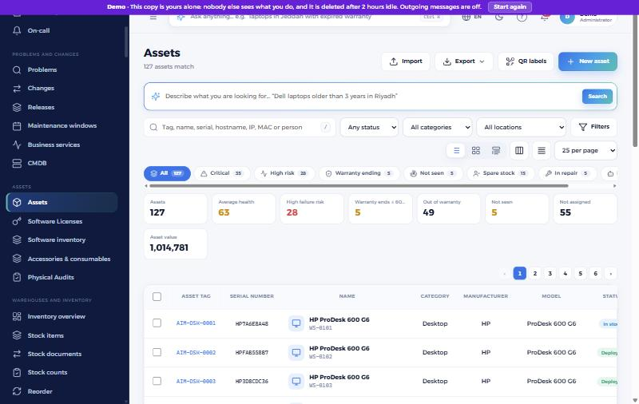

# منصة العمليات الذكية

**[English](README.md)** · من Unified Software Hub

منصة واحدة لإدارة عمليات الجهة: الأصول ومكتب الخدمة والموظفون والمالية وغيرها، باللغتين العربية والإنجليزية.

هذا المستودع هو الصفحة العامة **للنسخة التجريبية**، ولا يُنشر فيه الكود المصدري. يمكنك من خلاله تجربة المنصة والإبلاغ عن المشكلات واقتراح الأفكار.

## جرّب النسخة التجريبية

**[demo.unifiedsofthub.com](https://demo.unifiedsofthub.com/)**

| | |
|---|---|
| البريد الإلكتروني | `demo@unifiedsofthub.com` |
| كلمة المرور | `Demo@2026` |

- يحصل كل زائر على نسخة خاصة ببيانات تجريبية، ولا يرى أحد ما تفعله فيها.
- تُحذف نسختك بعد ساعتين دون نشاط، ويمنحك زر **ابدأ من جديد** نسخة جديدة في أي وقت.
- الرسائل الخارجية متوقفة.
- البيانات غير حقيقية، فلا تُدخل معلومات شخصية أو معلومات شركات حقيقية.

## ما يمكنك استكشافه

| المجال | يشمل |
|---|---|
| **مكتب الخدمة** | التذاكر ودليل الخدمات وقاعدة المعرفة والمشكلات والتغييرات |
| **الأصول** | الجرد وتراخيص البرامج والتدقيق والصيانة والمراقبة |
| **المستودعات والأسطول** | المخزون وجرد المخزون والمركبات |
| **الموظفون** | دليل الموظفين والموارد البشرية وبوابة الموظف |
| **المالية والمشتريات** | المحاسبة والموردون والمشتريات |
| **المبيعات والمشاريع** | إدارة العملاء وشكاوى العملاء والمشاريع |
| **الحوكمة** | المخاطر والامتثال والجودة والسلامة واللجان والشؤون القانونية |
| **منشئ التطبيقات** | بناء تطبيقاتك دون برمجة، مع سير العمل والموافقات ونماذج البوابة واللوحات |

### مكتب الخدمة

### الأصول

## ملاحظاتك

- **وجدت مشكلة؟** [أبلغ عنها](../../issues/new?template=bug_report.yml).
- **لديك فكرة؟** [اقترح ميزة](../../issues/new?template=feature_request.yml).
- **وجدت ثغرة أمنية؟** لا تفتح بلاغًا عامًا، وراجع [SECURITY.md](SECURITY.md).

## حقوق النشر

© 2026 Unified Software Hub. جميع الحقوق محفوظة. لا يُرخَّص إعادة استخدام المنصة أو اسمها أو شعارها أو صورها.

