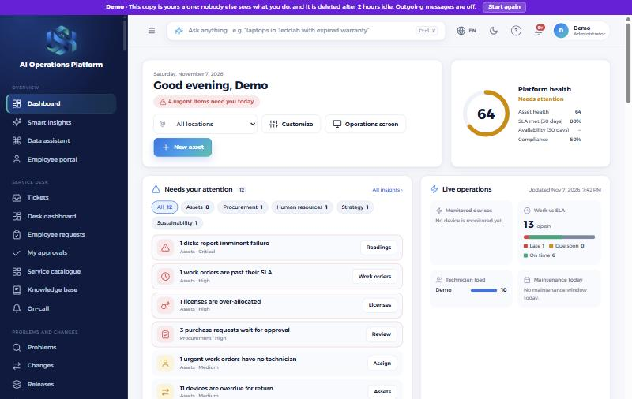
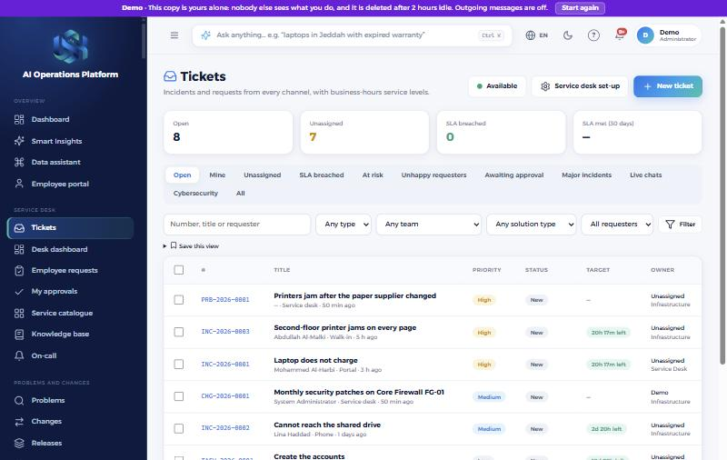
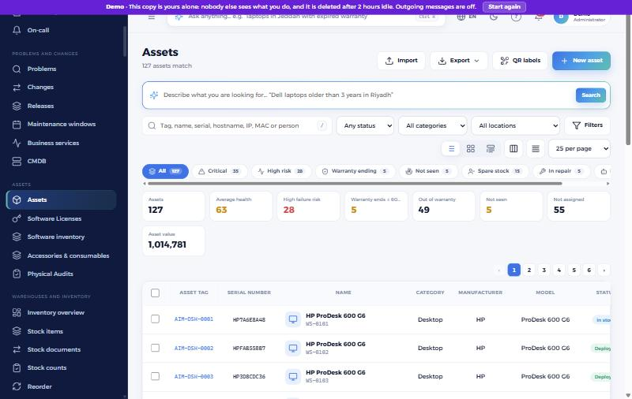
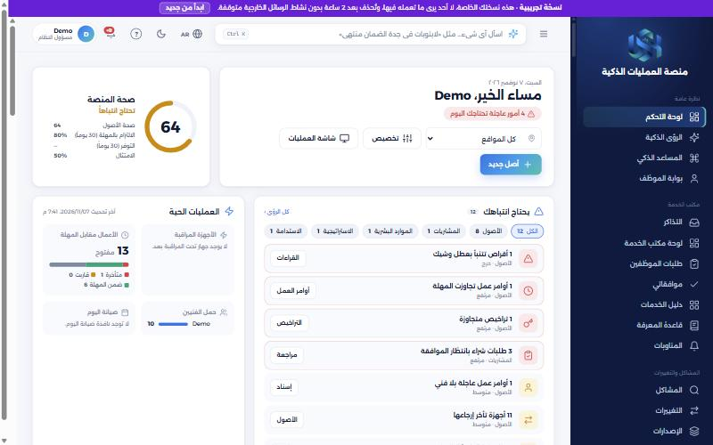

# AI Operations Platform

**[العربية](README.ar.md)** · by Unified Software Hub

One platform for running an organisation's operations: assets, service desk, people, finance and more, in Arabic and English.

This repository is the public home of the **live demo**. The source code is not published here. Use it to try the platform, report problems and suggest ideas.

## Try the demo

**[demo.unifiedsofthub.com](https://demo.unifiedsofthub.com/)**

| | |
|---|---|
| Email | `demo@unifiedsofthub.com` |
| Password | `Demo@2026` |

- Each visitor gets a private copy with sample data, and nobody else sees what you do in it.
- Your copy is deleted after 2 hours without activity. **Start again** gives you a fresh one at any time.
- Outgoing messages are off.
- The data is made up. Please do not enter real personal or company information.

## What you can explore

| Area | Includes |
|---|---|
| **Service desk** | Tickets, service catalogue, knowledge base, problems and changes |
| **Assets** | Inventory, software licences, audits, maintenance and monitoring |
| **Warehouses and fleet** | Stock, stock counts and vehicles |
| **People** | Employee directory, human resources and an employee portal |
| **Finance and procurement** | Accounting, suppliers and purchasing |
| **Sales and projects** | CRM, customer complaints and projects |
| **Governance** | Risk, compliance, quality, health and safety, committees and legal |
| **App builder** | Build your own applications without code, with workflows, approvals, portal forms and dashboards |

### Service desk

### Assets

### Arabic, right to left

## Feedback

- **Found a problem?** [Report a bug](../../issues/new?template=bug_report.yml).
- **Have an idea?** [Suggest a feature](../../issues/new?template=feature_request.yml).
- **Found a security issue?** Please do not open a public issue. See [SECURITY.md](SECURITY.md).

## Copyright

© 2026 Unified Software Hub. All rights reserved. The platform, its name, logo and screenshots are not licensed for reuse.
